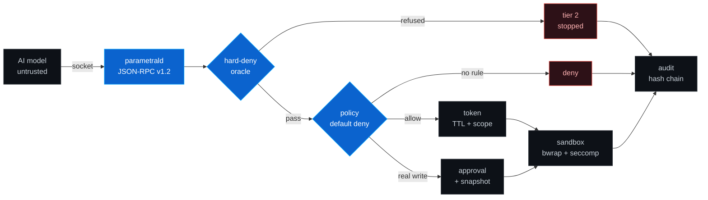

 

## Parametral OS

<picture>
  <source media="(prefers-color-scheme: dark)" srcset="https://raw.githubusercontent.com/EgeDevCat/parametral-os/master/assets/parametral-mark-256.png">
  <source media="(prefers-color-scheme: light)" srcset="https://raw.githubusercontent.com/EgeDevCat/parametral-os/master/assets/parametral-mark-light.svg">
  
</picture>

**An Arch + Nix system an AI can operate — but never own.**

The AI is treated as untrusted code with good intentions. It gets one socket, a short-lived capability token per operation, a sandbox per job, and a human gate for anything that touches the real machine. A separate deterministic oracle refuses a fixed list of irreversible operations *before* policy, tokens or approvals are consulted — it answers from a place the model cannot reach.

| Tier | What it permits | Cost of being wrong |
| :---: | --- | --- |
| **0** | rootless Nix profile inside a sandbox | nothing — throw the sandbox away |
| **1** | a real system write | an approval, a snapshot, a reviewed preset; no generic exec path |
| **2** | the irreversible | no path exists — not even a valid token buys one |

**[→ github.com/EgeDevCat/parametral-os](https://github.com/EgeDevCat/parametral-os)** &nbsp;·&nbsp; [API v1](https://github.com/EgeDevCat/parametral-os/blob/master/docs/API-v1.md) &nbsp;·&nbsp; [architecture](https://github.com/EgeDevCat/parametral-os/blob/master/docs/ARCHITECTURE.md) &nbsp;·&nbsp; [roadmap](https://github.com/EgeDevCat/parametral-os/blob/master/docs/ROADMAP.md)

## On the bench

| Project | What it is | Stack |
| --- | --- | --- |
| [ketsa](https://github.com/EgeDevCat/ketsa) | a general-purpose language: hand-written lexer, static type checker, bytecode VM, tree-walking interpreter, its own wiki | C++20 · CMake |
| [LagTrace](https://github.com/EgeDevCat/LagTrace) | Minecraft server diagnostics that name the hot chunks with coordinates instead of printing another TPS number | Java |
| [NovaExplorer](https://github.com/EgeDevCat/NovaExplorer) | Windows file manager on WinUI 3, packaged for x64 / arm64 / x86 | C# · XAML |
| [Nexus](https://github.com/EgeDevCat/Nexus) | terminal identity and system-inspection tool, JSON-backed | C# |

## How I work

- **Trust boundaries, not vibes.** If a decision can't be made by a process the model cannot write to, it isn't a security decision — it's a hope.
- **Stdlib first.** The gateway imports nothing third-party. Fewer moving parts isn't minimalism, it's something you can actually prove.
- **Fail closed.** Oracle gone means refuse, not warn. A swallowed exception is a vulnerability with good manners.
- **Tests that try to break it.** Sandbox escape, token scope, audit tampering, foreign uid on a socket — each one has a case that attempts it.
- **Contract before code.** The wire format is written and frozen first; the implementation catches up.

## The machine

CachyOS (Arch-based) is the daily driver — GCC, Clang, CMake, `cargo`, `pacman` + AUR, `systemd-boot`, `mkarchiso` when a live image is needed, fish as the shell. Windows targets happen too, mostly .NET and WinUI 3. No Docker anywhere in the loop: one binary beats a stack of manifests.

 

Issues on the repo you care about reach me faster than anything else.

